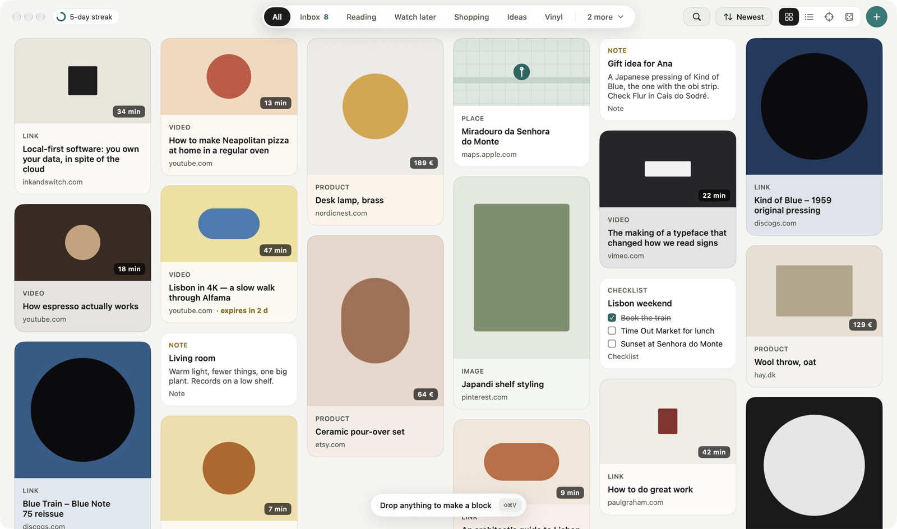

<p align="center">
  
</p>

<h1 align="center">Magpie</h1>

<p align="center">
  <b>Save anything. Actually come back to it.</b><br>
  A macOS app for links, images, videos, notes and files, instead of bookmark folders.
</p>

<p align="center">
  
  
  <a href="LICENSE"></a>
</p>

---

## Why

Browser bookmarks pile up in folders like "watch later" and "ideas" and never get opened again.
Magpie turns each save into a **Block** with a picture, keeps it in collections you can see,
and then nudges you to read, watch and use what you saved.

<p align="center">
  <picture>
    <source media="(prefers-color-scheme: dark)" srcset="docs/screenshot-dark.png">
    
  </picture>
</p>

## Features

- **Paste or drop anything.** Links get their title, picture and site name filled in on their own
- **Gallery** of image-first cards, each tinted with its picture's color
- **Collections**, with up to 5 pinned in the top bar
- **Details panel** for any Block
- Dark by default, with Light or Match my Mac in Settings
- Local and private. Everything stays on your Mac, with no account and no server
- Never locked in: File → Export Library writes everything to plain files (JSON, pictures, and a bookmarks file any browser imports)

Coming next: Sort Inbox, Lucky Dip, Rediscover, search, tags and Quick Save. See the [roadmap](ROADMAP.md).

## Build from source

You need macOS 26 and Xcode 26 (Swift 6.2) or the matching Swift toolchain.

```sh
git clone https://github.com/jleitaom/magpie.git
cd magpie
./build.sh --install    # builds, copies to /Applications and launches
```

To try it with sample data without touching your library:

```sh
open --env APP_STORE=/tmp/Magpie-demo.store --env APP_SEED=1 /Applications/Magpie.app
```

## Contributing

Issues and pull requests are welcome. See [CONTRIBUTING.md](CONTRIBUTING.md), and
[CHANGELOG.md](CHANGELOG.md) for what changed in each version.

## License

[MIT](LICENSE) © José Leitão

Magpie is an independent project and is not affiliated with Apple. macOS is a trademark of Apple Inc.
